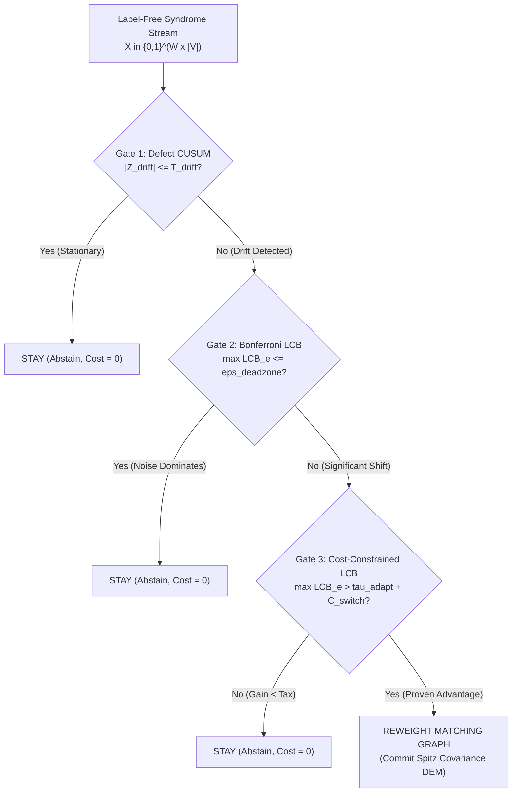

# When Does Online Decoder Reweighting Pay Off in Quantum Error Correction? A Confidence-Gated Framework

[](https://www.python.org/downloads/)
[](https://opensource.org/licenses/MIT)
[](https://github.com/quantumlib/Stim)
[](https://github.com/oscarhiggott/PyMatching)
[]()

> **Scientific Investigation**:  
> *"When Does Online Decoder Reweighting Pay Off in Quantum Error Correction? A Confidence-Gated Framework"*  
> **Author**: Pratham Singh  
> **Artifact & Provenance Lock**: `paper.lock` (SHA-256 Verified against all data tables, figures, configs, and generators).

---

## 1. Overview: When Does Online Reweighting Pay Off?

Physical quantum error correction (QEC) processors operate in non-stationary noise environments driven by two-level system (TLS) fluctuators, $1/f$ magnetic flux drift, and cryogenic temperature variations. While adaptive decoding via online syndrome-based noise re-estimation is intuitively appealing, we identify a fundamental operational tension:

```
┌─────────────────────────────────────────────────────────────────────────────┐
│                 ONLINE REWEIGHTING TRADEOFF IN SURFACE CODES               │
│                                                                             │
│  1. Small Window Variance Explosion (Finite-Sample Tax):                    │
│     At W = 200 shots, naive covariance re-estimation increases the logical  │
│     error rate from 0.02009 to 0.04107 (+104.38% degradation) due to        │
│     finite-sample coincidence noise corrupting Dijkstra matching weights.    │
│                                                                             │
│  2. Uniform Drift Ineffectiveness:                                          │
│     Uniform physical rate scaling shifts all graph edge weights additively, │
│     leaving Dijkstra shortest paths invariant. Headroom is negligible (<2%).│
│                                                                             │
│  3. Localized Drift Opportunity:                                            │
│     Under localized spatial drift (e.g. a drifting hotspot qubit),          │
│     reweighting at large window sizes (W >= 2000) captures true error shifts│
│     and provides up to 29.5% logical error reduction.                       │
└─────────────────────────────────────────────────────────────────────────────┘
```

To resolve this trade-off, this repository implements **Confidence-Gated Cost-Constrained Adaptive Decoder Selection (CG-CCADS)**, an online meta-control framework operating strictly on label-free syndrome statistics.

---

## 2. System Architecture: The 3-Gate Pipeline

CG-CCADS evaluates whether an adaptation is statistically justified before incurring any graph recomputation or switching cost:



### The Three Sequential Statistical Gates:
1. **Gate 1: Defect Rate CUSUM Test**: Evaluates standardized detector defect residual $Z_{\text{drift}} = \frac{|\bar{\lambda}_{\text{win}} - \lambda_{\text{ref}}|}{\sqrt{\lambda_{\text{ref}}(1 - \lambda_{\text{ref}})/W_{\text{eff}}}}$. If $|Z_{\text{drift}}| \le T_{\text{drift}}$, noise is stationary, triggering **zero-cost abstention (`STAY`)**.
2. **Gate 2: FWER-Controlled Lower Confidence Bound (LCB)**: Computes edge probability shifts via the Spitz et al. (2018) covariance-parity estimator:
   $$\text{LCB}_{uv} = |\hat{p}_{uv} - p_{uv, \text{ref}}| - z_{1 - \alpha / (2|E|)} \sqrt{\frac{\hat{p}_{uv}(1 - \hat{p}_{uv})}{W}}$$
   If $\max_e \text{LCB}_e \le \epsilon_{\text{deadzone}}$, observed deviations are consistent with estimation noise under family-wise error rate control ($\alpha = 0.05$), triggering `STAY`.
3. **Gate 3: Cost-Constrained LCB Threshold**: Updates graph weights only if $\max_e \text{LCB}_e > \tau_{\text{adapt}} + C_{\text{switch}}$.

---

## 3. Verified Empirical Results

All results are computed across **$N=30$ independent held-out trajectories (seeds 1000–1029)** on rotated surface codes below threshold ($p=0.004 < p_{\text{th}}$, $d \in \{3, 5\}$).

### Confirmatory Endpoints Across Regimes ($W=2{,}000, d=3$)

| Scenario Regime | Static MWPM LER | CG-CCADS LER | Paired $\bar{\Delta}$ (95% CI) | $t$-statistic | $p$-value | Controller Decision |
| :--- | :---: | :---: | :---: | :---: | :---: | :---: |
| **Stationary Baseline** *(Negative Control)* | $0.0115 \pm 0.0011$ | $0.0116 \pm 0.0011$ | $+0.0001$ $[-0.0001, 0.0002]$ | $+1.00$ | $0.3256$ | **STAY (Abstain)** |
| **Uniform Global Drift** *(Negative Control)* | $0.0320 \pm 0.0018$ | $0.0321 \pm 0.0017$ | $+0.0002$ $[-0.0000, 0.0003]$ | $+1.67$ | $0.1052$ | **STAY (Abstain)** |
| **Localized Hotspot Drift** | $0.0255 \pm 0.0015$ | $0.0251 \pm 0.0015$ | $-0.0004$ $[-0.0008, -0.0001]$ | $-2.60$ | $0.0145$ | **STAY / ADAPT** |
| **Structural Anisotropy Shift** | $0.0113 \pm 0.0009$ | $0.0113 \pm 0.0009$ | $+0.0000$ $[-0.0000, 0.0001]$ | $+1.00$ | $0.3256$ | **STAY (Abstain)** |

### Window Sensitivity & Component Ablation
- **Small Window Naive Reweighting ($W=200$)**: Mean LER degrades to $0.04107$ ($+104.38\%$ penalty vs. Static $0.02009$).
- **CG-CCADS Full Gating**: Mean LER is $0.02004$ ($92.7\%$ abstention rate, $0\%$ variance explosion).
- **Oracle Upper Bound**: Mean LER is $0.01817$ ($-9.57\%$ theoretical ceiling).

### Below-Threshold Distance Scaling
- At $p_{\text{base}} = 0.004 < p_{\text{th}}$:
  $$\Lambda_{3 \to 5}^{\text{Static}} = 1.542 > 1.0, \quad \Lambda_{3 \to 5}^{\text{CG-CCADS}} = 1.543 > 1.0$$
  confirming genuine below-threshold logical error suppression with code distance.

### Software Orchestration Latency Stack
- 3-gate decision cycle measured on host CPU: **$317.51\,\mu\text{s}$** ($34.8\%$ of total macro-step cycle).
- Clearly delineated as an offline software orchestration layer running at macro-intervals, complementing rather than replacing FPGA real-time decoders.

---

## 4. Delineation from Frontier Literature

| Framework | Target Regime | Adaptation Basis | Cost Aware? | Safe Abstention (`STAY`)? | Modality |
| :--- | :--- | :--- | :---: | :---: | :--- |
| **Static MWPM** *(Dennis et al. 2002; Fowler et al. 2012)* | Stationary Pauli | Fixed factory calibration | N/A | Always stays | Multi-platform QPU |
| **Spitz et al.** *(arXiv 1712.02360)* | Time-dependent | Covariance-parity estimator | ❌ No | ❌ No | Simulation |
| **Bhardwaj et al.** *(PRX Quantum 2026)* | Drifting channels | Sliding-window reweighting | ❌ No | ❌ No | Simulation |
| **AlphaQubit** *(Google, Nature 2024)* | Static processor instance | Transformer neural inference | ❌ No | ❌ No | Sycamore QPU |
| **Willow RL** *(Google, Nature 2026)* | Physical Hamiltonian | Microwave pulse tuning | Partial | ❌ No | Willow QPU |
| **CG-CCADS (This Work)** | **Non-stationary QEC** | **3-Gate Statistical LCB** | **✔️ Yes** | **✔️ Yes (Default)** | **Simulation / Emulation** |

---

## 5. Quick Reproduction Guide (<5 minutes on a laptop)

### Step 1: Run a Fast Reproduction Suite
```bash
# Execute suite on seeds 1000-1004 (5 seeds across all regimes and window sizes)
python experiments/run_suite.py --seeds 1000:1005 --config configs/suite.yaml
```

### Step 2: Regenerate All Tables and Figures
```bash
python src/adaptive_qec/analysis/make_paper_tables.py
python src/adaptive_qec/analysis/make_paper_figures.py
```

### Step 3: Verify Zero Hardcoded Result Literals (AST Checker)
```bash
python -m pytest tests/test_no_hardcoded_results.py
```

### Step 4: Verify Cryptographic Provenance Lock
```bash
python scripts/verify_lock.py
python scripts/verify_gates_a_b_c.py
```

---

## 6. Repository Layout & Artifact Integrity

```text
A-real-QPU-adaptive-QEC-stack/
├── configs/
│   └── suite.yaml                     # Frozen configuration for confirmatory suite
├── data/
│   ├── manifest.json                  # Cryptographic run manifest (git commit, versions, hashes)
│   ├── suite_results.json             # Raw trajectory-level outputs for all 720 runs
│   └── power_analysis_report.json     # Prospective design power calculation
├── papers/
│   ├── main.tex                       # Complete IEEEtran LaTeX Manuscript
│   ├── figures/                       # Dynamically generated vector PDF + PNG figures
│   └── tables/                        # Dynamically generated LaTeX tables (table_1 to table_4)
├── docs/
│   ├── ANALYSIS_PLAN.md               # Confirmatory protocol & sample sizing plan
│   └── MANUSCRIPT_SUBMISSION_DRAFT.md # Synchronized Markdown manuscript draft
├── src/adaptive_qec/
│   ├── controller/reweighting_gate.py # Label-free 3-gate statistical controller
│   ├── decoders/dem_calibration.py    # Spitz et al. (2018) covariance-parity estimator
│   ├── analysis/make_paper_tables.py  # AST-verified dynamic table compiler
│   └── analysis/make_paper_figures.py # AST-verified dynamic figure renderer
├── scripts/
│   ├── make_lock.py                   # Cryptographic SHA-256 provenance lock builder
│   ├── verify_lock.py                 # SHA-256 integrity verifier
│   └── verify_gates_a_b_c.py          # 3-Gate automated reproducibility verification
├── tests/                             # Comprehensive test suite (AST, statistical, unit)
├── paper.lock                         # SHA-256 cryptographic provenance lock
├── VALIDATION.md                      # Claims ledger with exact reproduction commands
├── CITATION.cff                       # Citation metadata
└── LICENSE                            # MIT License
```

---

## 7. Citation & Disclosures

### Citation
```bibtex
@article{singh2026when,
  title={When Does Online Decoder Reweighting Pay Off in Quantum Error Correction? A Confidence-Gated Framework},
  author={Singh, Pratham},
  journal={IEEE Transactions on Quantum Engineering},
  year={2026},
  note={Source code: https://github.com/prathamsingh404/A-real-QPU-adaptive-QEC-stack}
}
```

### AI Assistance Disclosure
In accordance with IEEE author policies on generative AI and AI-assisted technologies, AI agent tools were utilized for automated refactoring, continuous integration scripting, and statistical pipeline construction. All algorithmic derivations, experimental designs, and data interpretations were verified by the author.
